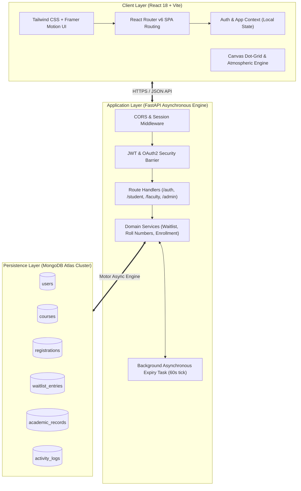
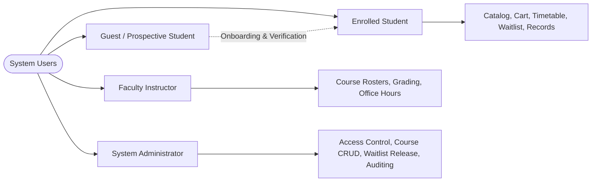
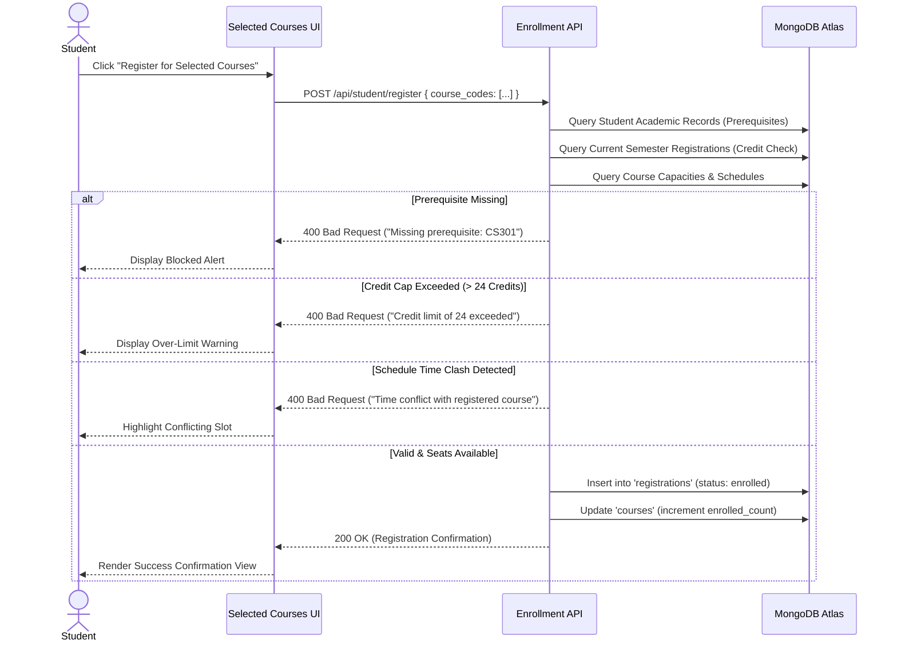
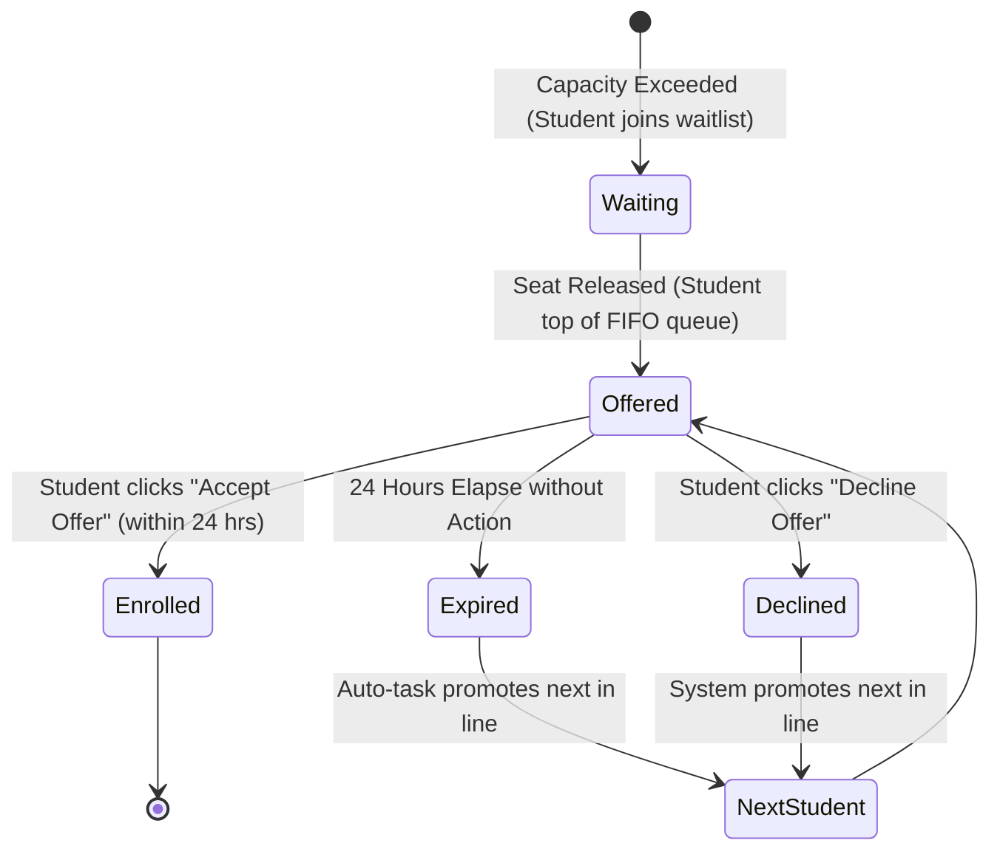
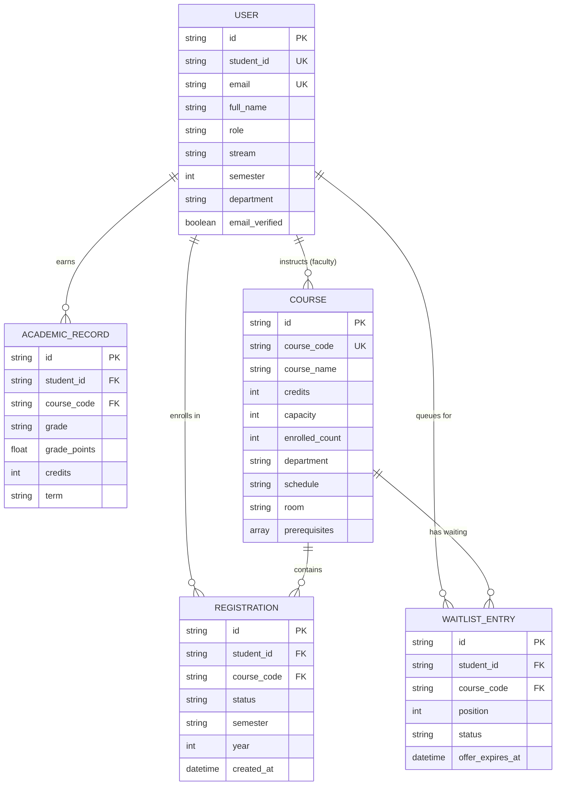

# Software Requirements Specification (SRS)
## Westbridge University Course Catalog and Registration System (CCRS)

---

### Document Control
- **Document Version**: 1.0.0
- **Status**: Approved / Production Baseline
- **Date**: November 15, 2026
- **System**: Westbridge University CCRS (Course Catalog and Registration System)
- **Author**: Westbridge University Systems Architecture Group
- **Standard**: Formatted according to IEEE 830-1998 / ISO/IEC/IEEE 29148:2018 Standards

---

## Table of Contents
1. [Introduction](#1-introduction)
   - 1.1 Purpose
   - 1.2 Document Conventions
   - 1.3 Intended Audience & Reading Suggestions
   - 1.4 Product Scope
   - 1.5 Definitions, Acronyms, and Abbreviations
2. [Overall Description](#2-overall-description)
   - 2.1 Product Perspective & High-Level Architecture
   - 2.2 Product Functions Overview
   - 2.3 User Classes and Personas
   - 2.4 Operating Environment & Technology Stack
   - 2.5 Design and Implementation Constraints
   - 2.6 Assumptions and Dependencies
3. [External Interface Requirements](#3-external-interface-requirements)
   - 3.1 User Interfaces (UI/UX & Design System)
   - 3.2 Hardware Interfaces
   - 3.3 Software & Cloud Interfaces
   - 3.4 Communications & Security Protocols
4. [System Features & Functional Requirements](#4-system-features--functional-requirements)
   - 4.1 Authentication, Institutional Identity & Onboarding (FR-AUTH)
   - 4.2 Course Catalog, Discovery & Inspection Drawer (FR-CAT)
   - 4.3 Selected Courses (Cart) & Enrollment Validation (FR-ENR)
   - 4.4 Automated Timetable & Real-Time Clash Detection (FR-TIME)
   - 4.5 Priority Waiting List & Automated Seat Offer Engine (FR-WAIT)
   - 4.6 Academic Records, Degree Audit & Grade Ledger (FR-REC)
   - 4.7 Faculty Course Console & Grading (FR-FAC)
   - 4.8 Administrator Governance & Access Control (FR-ADM)
5. [Non-Functional Requirements (NFRs)](#5-non-functional-requirements-nfrs)
   - 5.1 Performance & Latency Benchmarks
   - 5.2 System Reliability & Fault Tolerance
   - 5.3 Security, Authorization & Privacy Controls
   - 5.4 Software Quality Attributes & Usability
6. [Data Models & Schema Specifications](#6-data-models--schema-specifications)
   - 6.1 Entity-Relationship Model
   - 6.2 Database Collections & Data Dictionaries
7. [System Verification & Acceptance Criteria](#7-system-verification--acceptance-criteria)
   - 7.1 Requirements Traceability Matrix
   - 7.2 Verification Scenarios

---

## 1. Introduction

### 1.1 Purpose
This Software Requirements Specification (SRS) provides a comprehensive, authoritative description of the **Westbridge University Course Catalog and Registration System (CCRS)**. It establishes the functional, behavioural, and non-functional requirements for the university's mission-critical academic scheduling, registration, waiting list automation, and role-based portal operations.

### 1.2 Document Conventions
- **Requirement IDs**: Each requirement is uniquely identified using `FR-[MODULE]-[NUMBER]` for functional requirements and `NFR-[CATEGORY]-[NUMBER]` for non-functional requirements.
- **Priority Keywords**: Following RFC 2119:
  - **SHALL / MUST**: Absolute operational requirement.
  - **SHOULD**: Strongly recommended architectural practice.
  - **MAY**: Optional or future-extended capability.
- **Visual Styling Standards**: Midnight Navy (`#071426`, `#0A192B`), Slate Blue (`#1E344D`), Teal/Cyan accents (`#14B8A6`, `#06B6D4`), and standard monospace code identifiers.

### 1.3 Intended Audience & Reading Suggestions
- **Software Engineers & Full-Stack Developers**: Refer to Section 3 (Interfaces), Section 4 (System Features), and Section 6 (Data Models).
- **QA Engineers & Testers**: Refer to Section 4 (Functional Requirements) and Section 7 (Acceptance Criteria).
- **University Administrators & Academic Deans**: Refer to Section 2 (Product Description) and Section 4.8 (Administrative Governance).
- **Security & Infrastructure Auditors**: Refer to Section 3.4 (Communications) and Section 5.3 (Security Specifications).

### 1.4 Product Scope
The CCRS is a responsive, web-based enterprise university portal that orchestrates term-based course enrollment for Westbridge University. It bridges student self-service, faculty grade management, and central administrative oversight into an integrated single page application (SPA) backed by asynchronous Python APIs and cloud document storage.

Key operational capabilities:
- Multi-channel authentication (Institutional credentials, Google OAuth 2.0, GitHub OAuth 2.0).
- Streamlined student onboarding with automated institutional roll number generation.
- Dynamic course catalog with instant search, stream filtering, and course inspection drawer.
- Prerequisite validation and schedule conflict prevention.
- Automated interactive weekly timetable with real-time course preview clash analysis.
- Live waitlist management with an automated 24-hour seat release countdown engine.
- Student academic history and real-time degree audit tracker.
- Faculty grade submission and course syllabus management with strict access control.
- Administrative curriculum management with directed acyclic graph (DAG) cycle detection.

### 1.5 Definitions, Acronyms, and Abbreviations
| Acronym / Term | Definition |
| :--- | :--- |
| **CCRS** | College Course Registration System |
| **JWT** | JSON Web Token (RFC 7519) |
| **RBAC** | Role-Based Access Control |
| **SPA** | Single Page Application |
| **DAG** | Directed Acyclic Graph (prerequisite validation) |
| **FIFO** | First In, First Out (waitlist ordering algorithm) |
| **CGPA** | Cumulative Grade Point Average |
| **Motor** | Asynchronous Python driver for MongoDB |
| **Pydantic** | Data validation and parsing library for Python |
| **Vite** | Modern frontend build tool and dev server |

---

## 2. Overall Description

### 2.1 Product Perspective & High-Level Architecture
The Westbridge University CCRS operates as a decoupled 3-tier client-server system communicating over RESTful JSON web services.

### 2.2 Product Functions Overview
1. **Student Registration Console**: Interactive dashboard showing active registrations, pending waitlists, countdown seat offers, degree audits, and deadline agendas.
2. **Dynamic Course Discovery**: Interactive searchable catalog with faceted filtering (department, stream, credits, delivery mode) and an animated slide-in drawer.
3. **Cart & Registration Engine**: Pre-enrollment validation verifying prerequisite completion, maximum credit ceilings (24 credits/semester), and schedule compatibility.
4. **Interactive Timetable Matrix**: Visual schedule mapping course times across Monday through Friday with preview clash indicators.
5. **Intelligent Waitlist Processor**: Automated sequential waitlist queue promotion with a 24-hour expiration window on seat release.
6. **Faculty Classroom Ledger**: Instructor tools to inspect student rosters, submit letter grades, and adjust course syllabus details.
7. **Administrative Oversight Engine**: Centralized dashboard to provision faculty accounts, manage course capacities, and inspect security audit logs.

### 2.3 User Classes and Personas

- **Student User**: Requires access to self-service registration, cart validation, timetable planning, and grade tracking. Must be enrolled and email-verified.
- **Faculty User**: Requires authenticated access to courses assigned specifically to their faculty ID. Authorized to view student rosters and enter grades. Restricted from altering course capacities or prerequisite graphs.
- **System Administrator**: Superuser with complete governance over user accounts, faculty provisioning, course creation, prerequisite DAG integrity, and waitlist releases.
- **Guest / OAuth Visitor**: Unauthenticated or newly authenticated OAuth user requiring email onboarding and stream selection.

### 2.4 Operating Environment & Technology Stack
- **Frontend Runtime**: Modern web browsers supporting ES2022 and HTML5 Canvas (Chrome 110+, Firefox 110+, Safari 16+, Edge 110+).
- **Frontend Stack**: React 18.2, Vite 5.x, Tailwind CSS 3.4, Framer Motion, Lucide Icons, Material Symbols.
- **Backend Runtime**: Python 3.10+ on Windows, Linux, or macOS.
- **Backend Framework**: FastAPI 0.100+, Uvicorn (ASGI server), Starlette, Pydantic v2.
- **Database Engine**: MongoDB 6.0+ (MongoDB Atlas or standalone cluster).
- **Authentication**: OAuth 2.0 (Google, GitHub), PyJWT, Passlib with Bcrypt.
- **Email Service**: SMTP over TLS/SSL (Gmail SMTP / Institutional Relay).

### 2.5 Design and Implementation Constraints
1. **Design System Consistency**: The frontend must adhere strictly to the established Midnight Navy design palette (`#071426`, `#0A192B`, `#1E344D`) and neon teal/cyan accents without arbitrary redesigns.
2. **Single Source of Truth**: Active enrollment counts must strictly derive from the `registrations` collection rather than decoupled counters.
3. **Credit Limits**: Maximum enrollment cap per student is strictly enforced at 24 credits per semester.
4. **Bcrypt 72-Byte Boundary**: Passwords must be handled gracefully within the 72-byte truncation specification.

---

## 3. External Interface Requirements

### 3.1 User Interfaces (UI/UX & Design System)
- **Global Visual Identity**: Dark theme incorporating Midnight Navy surfaces, custom scrollbars, and an interactive HTML5 canvas dot-grid background with mouse repulsion and spotlight illumination.
- **Collapsible Top Navigation**: Topbar and TopNav featuring an auto-hide behaviour (resembling OS taskbar auto-hide), an invisible top trigger zone (`h-2 fixed top-0`), 1.5-second slide-out transitions, interactive institutional branding, and active seat offer badge indicators.
- **Responsive Layout**: Fluid breakpoints supporting Mobile (<640px), Tablet (640px–1024px), and Desktop (1024px+).
- **Slide-in Drawers**: Course details display via a smooth right-to-left animated drawer with prerequisite chips and faculty badges.

### 3.2 Hardware Interfaces
The CCRS has no direct hardware interfaces. Client devices communicate over standard IP network interfaces (Wi-Fi, Ethernet, 4G/5G mobile).

### 3.3 Software & Cloud Interfaces
- **MongoDB Atlas**: Managed multi-region document store accessed via `motor.motor_asyncio.AsyncIOMotorClient`.
- **Google OAuth 2.0**: Protocol exchange with `https://accounts.google.com/o/oauth2/auth` for federated identity verification.
- **GitHub OAuth 2.0**: Protocol exchange with `https://github.com/login/oauth/authorize` for developer identity verification.
- **SMTP Gateway**: Outbound mail delivery on port 587 (STARTTLS) for student verification codes.

### 3.4 Communications & Security Protocols
- **API Exchange**: JSON over HTTPS with mandatory TLS 1.3 encryption.
- **Cross-Origin Resource Sharing (CORS)**: Strict origin validation allowing specified development (`http://localhost:5173`) and production domains.
- **Session Tokens**: Bearer JWT tokens passed in HTTP `Authorization: Bearer <token>` headers with 60-minute expiration.

---

## 4. System Features & Functional Requirements

### 4.1 Authentication, Institutional Identity & Onboarding (FR-AUTH)

#### FR-AUTH-01: Multi-Channel Authentication
- **Description**: The system shall authenticate users via local database credentials (email/student ID + password) and third-party OAuth providers (Google and GitHub).
- **Inputs**: Username/Email/Student ID, password, or OAuth authorization grant.
- **Processing**:
  1. Validate credentials against the `users` collection.
  2. For local accounts, verify the bcrypt password hash.
  3. Verify that `email_verified` is true and `is_active` is true.
  4. Issue a signed JWT access token containing `sub`, `email`, `role`, and `name`.
- **Outputs**: Access token and User profile response.

#### FR-AUTH-02: Self-Service Student Onboarding
- **Description**: New students (including OAuth first-time visitors) shall complete an onboarding flow specifying their academic stream and profile details.
- **Inputs**: Full name, email, chosen stream (CS, SE, DS, AI, CY), entry year, date of birth, contact details.
- **Processing**:
  1. Validate email domain and uniqueness.
  2. Dynamically assign a system-generated student ID and roll number in the format `WU-[YEAR]-[STREAM]-[SEQUENCE]` (e.g., `WU-2026-CS-042`).
  3. Dispatch an email verification code via SMTP.
  4. Upon code confirmation, mark `email_verified: true` and `is_onboarded: true`.

#### FR-AUTH-03: Role-Based Route Guards
- **Description**: The frontend and backend shall restrict access to endpoints based on user roles (`student`, `faculty`, `admin`).
- **Processing**: Backend dependencies (`get_current_user`, `require_role`) reject unauthorized calls with HTTP 403 Forbidden.

---

### 4.2 Course Catalog, Discovery & Inspection Drawer (FR-CAT)

#### FR-CAT-01: Course Search & Multi-Faceted Filtering
- **Description**: The system shall provide real-time search across course codes, titles, instructors, and departments.
- **Filtering Capabilities**:
  - Academic Department (e.g., Computer Science, Software Engineering).
  - Credit Weighting (1–4 credits).
  - Seat Status (Open, Waitlist Available, Full).
  - Academic Term (e.g., Fall 2026, Spring 2027).

#### FR-CAT-02: Course Inspection Drawer
- **Description**: Clicking a course card shall open a slide-in side drawer displaying detailed metadata without navigating away from the catalog.
- **Displayed Data**:
  - Full syllabus description and learning objectives.
  - Required prerequisites with student eligibility badges (Completed vs. Missing).
  - Schedule, lecture hall room allocation, and meeting times.
  - Assigned faculty member with office hours.
  - Live seat capacity, enrolled count, and remaining seats.

---

### 4.3 Selected Courses (Cart) & Enrollment Validation (FR-ENR)

#### FR-ENR-01: Prerequisite Compliance Check
- The enrollment engine shall recursively check the student's completed academic records before approving registration. If any prerequisite course is unfulfilled, enrollment shall be blocked.

#### FR-ENR-02: Credit Limit Enforcement
- The system shall ensure a student cannot exceed 24 total registered credits per academic semester.

#### FR-ENR-03: Atomic Enrollment
- Registration shall atomically verify seat availability and create the registration record, preventing race conditions during high-demand registration windows.

---

### 4.4 Automated Timetable & Real-Time Clash Detection (FR-TIME)

#### FR-TIME-01: Dynamic Weekly Matrix
- **Description**: The system shall render a weekly grid (Monday through Friday, 08:00 to 18:00) visualizing all confirmed course meetings.
- **Rendering**: Color-coded blocks displaying course code, title, instructor, and classroom.

#### FR-TIME-02: Preview Slot Clash Detection
- **Description**: When viewing an unselected course, the client shall query `/courses/{course_code}/preview-slot` against current cart items.
- **Behaviour**: If the previewed course overlaps in day and time with an already-selected course, the timetable shall highlight both slots in warning crimson and disable one-click addition.

---

### 4.5 Priority Waiting List & Automated Seat Offer Engine (FR-WAIT)

#### FR-WAIT-01: Automatic Waitlist Spillover
- When a course reaches 100% capacity (`enrolled_count >= capacity`), the student shall be prompted to join the waitlist.
- Waitlist entries receive a strictly sequential position number based on insertion timestamp.

#### FR-WAIT-02: 24-Hour Expiration Seat Offer
- Upon a seat becoming available (drop or manual administrative release), the top-ranking waitlist student receives an exclusive `offered` status.
- An expiration timestamp (`offer_expires_at = now + 24 hours`) is set.
- The student's dashboard displays a prominent banner with a live countdown timer (`Xh Ym Zs`).

#### FR-WAIT-03: Asynchronous Expiration Worker
- A continuous background asyncio worker runs every 60 seconds (`_periodic_expire_offers_task`) checking for expired offers.
- Any offer where `offer_expires_at <= now` is automatically cancelled, and the offer is immediately dispatched to the next student in the queue.

---

### 4.6 Academic Records, Degree Audit & Grade Ledger (FR-REC)

#### FR-REC-01: Cumulative GPA Calculation
- The system shall dynamically compute Cumulative Grade Point Average (CGPA) and Term GPA based on official university 4.0 grading scales ($A=4.0, B=3.0, C=2.0, D=1.0, F=0.0$).

#### FR-REC-02: Degree Progression Audit
- The degree audit screen shall categorize completed, in-progress, and unfulfilled requirements against the student's program requirements (Core Computing, Mathematics, Electives, Capstone).

---

### 4.7 Faculty Course Console & Grading (FR-FAC)

#### FR-FAC-01: Faculty Course Assignment
- Faculty members shall only view and modify courses where `faculty_name` or `faculty_id` matches their institutional credentials.

#### FR-FAC-02: Grade Submission
- Instructors can input term letter grades for enrolled students. Once finalized, grades write to `academic_records` and lock against further student manipulation.

---

### 4.8 Administrator Governance & Access Control (FR-ADM)

#### FR-ADM-01: Course CRUD & Prerequisite DAG Cycle Detection
- Administrators can create, edit, and archive courses.
- When configuring prerequisites, the system executes a cycle detection algorithm to verify that prerequisite dependencies form a valid Directed Acyclic Graph (DAG) and do not produce circular dependencies (e.g., A requires B, B requires A).

#### FR-ADM-02: Faculty Access Control
- Administrators can create faculty accounts, adjust departmental assignments, and issue password reset links.

#### FR-ADM-03: Waitlist Governance & Manual Seat Release
- Administrators can view global waitlists across all courses, reorder queues, or manually release reserved seats to waitlisted students.

---

## 5. Non-Functional Requirements (NFRs)

### 5.1 Performance & Latency Benchmarks
- **NFR-PERF-01 (API Response Time)**: 95% of read requests (catalog, timetable, profile) shall complete within $\le 150\text{ ms}$ under normal operational load.
- **NFR-PERF-02 (Database Indexing)**: Compound indexes on `{"course_code": 1, "status": 1}` and `{"student_id": 1, "status": 1}` shall ensure $O(\log N)$ query times.
- **NFR-PERF-03 (Client Render Time)**: Dynamic page transitions and drawer keyframe animations shall render at consistent 60 frames per second (FPS).

### 5.2 System Reliability & Fault Tolerance
- **NFR-REL-01 (Continuous Worker Resiliency)**: The waitlist expiration task shall catch all internal exceptions and maintain recurring execution without process crashes.
- **NFR-REL-02 (Database Connection Pooling)**: The Motor async client shall maintain an active connection pool with automatic reconnect on transient network disruptions.

### 5.3 Security, Authorization & Privacy Controls
- **NFR-SEC-01 (Cryptographic Hashing)**: All passwords shall be hashed using bcrypt with auto-generated salts. Input strings longer than 72 bytes are safely truncated prior to hashing.
- **NFR-SEC-02 (Token Signing & Expiry)**: Access tokens use HMAC-SHA256 (HS256) signing with a 256-bit secret key and strict 60-minute expiration.
- **NFR-SEC-03 (Audit Trail)**: Security-sensitive operations (password resets, role elevation, manual seat releases) shall write immutable log records to `activity_logs`.

### 5.4 Software Quality Attributes & Usability
- **NFR-QUAL-01 (Accessibility)**: All buttons, modal dialogues, and form controls shall feature appropriate ARIA labels and keyboard focus ring indicators.
- **NFR-QUAL-02 (Maintainability)**: High separation of concerns between domain controllers, schemas, route definitions, and frontend hook abstractions.

---

## 6. Data Models & Schema Specifications

### 6.1 Entity-Relationship Model

### 6.2 Database Collections & Data Dictionaries

#### 1. `users` Collection
| Field | Type | Description |
| :--- | :--- | :--- |
| `_id` | ObjectId | MongoDB unique identifier |
| `student_id` | String | Unique institutional roll number (e.g. `WU-2026-CS-001`) |
| `email` | String | Institutional email address (Indexed, Unique) |
| `full_name` | String | Full legal user name |
| `role` | String | User role: `'student'`, `'faculty'`, `'admin'` |
| `stream` | String | Academic stream (e.g., `'Computer Science'`) |
| `semester` | Integer | Current academic semester (1–8) |
| `hashed_password` | String | Bcrypt hash representation |
| `provider` | String | Auth source: `'local'`, `'google'`, `'github'` |
| `is_active` | Boolean | Account operational status |
| `email_verified` | Boolean | Verification flag for student accounts |

#### 2. `courses` Collection
| Field | Type | Description |
| :--- | :--- | :--- |
| `_id` | ObjectId | MongoDB unique identifier |
| `course_code` | String | Catalog code (e.g. `'CS301'`, Indexed, Unique) |
| `course_name` | String | Descriptive title |
| `credits` | Integer | Academic credit weight (1–4) |
| `capacity` | Integer | Maximum enrolled student limit |
| `enrolled_count` | Integer | Current number of active students |
| `faculty_name` | String | Assigned faculty instructor name |
| `schedule` | String | Meeting timetable pattern (e.g., `'Mon, Wed 10:00 – 11:30 AM'`) |
| `room` | String | Assigned physical lecture hall |
| `prerequisites` | Array[String]| List of prerequisite course codes |
| `status` | String | `'open'`, `'waitlist'`, or `'full'` |

#### 3. `registrations` Collection
| Field | Type | Description |
| :--- | :--- | :--- |
| `_id` | ObjectId | MongoDB unique identifier |
| `student_id` | String | Foreign key to student user |
| `course_code` | String | Foreign key to course code |
| `status` | String | `'enrolled'`, `'dropped'`, `'completed'` |
| `semester` | String | Enrollment semester (`'Fall'`) |
| `year` | Integer | Academic year (e.g., `2026`) |
| `created_at` | DateTime | Timestamp of confirmed enrollment |

#### 4. `waitlist_entries` Collection
| Field | Type | Description |
| :--- | :--- | :--- |
| `_id` | ObjectId | MongoDB unique identifier |
| `student_id` | String | Foreign key to student user |
| `course_code` | String | Foreign key to course code |
| `position` | Integer | Sequential FIFO queue index |
| `status` | String | `'waiting'`, `'offered'`, `'expired'`, `'declined'` |
| `joined_at` | DateTime | Queue entry timestamp |
| `offered_at` | DateTime | Timestamp when seat offer was extended |
| `offer_expires_at`| DateTime | 24-hour expiration deadline |

---

## 7. System Verification & Acceptance Criteria

### 7.1 Requirements Traceability Matrix
| Requirement ID | Module | Implementation Target | Verification Method |
| :--- | :--- | :--- | :--- |
| **FR-AUTH-01** | Identity | `auth_controller.py`, `Login.jsx` | Integration Test & Token Inspection |
| **FR-AUTH-02** | Onboarding | `Register.jsx`, `roll_numbers.py` | Unit Test & SMTP Mocking |
| **FR-CAT-01** | Discovery | `CourseCatalog.jsx`, `course_routes.py` | UI Verification & Search Benchmarking |
| **FR-CAT-02** | Inspection | `CourseDrawer.jsx`, `index.css` | Component E2E Rendering Test |
| **FR-ENR-01** | Cart | `student_controller.py`, `SelectedCourses.jsx` | Boundary Value Testing (Prerequisites) |
| **FR-ENR-02** | Limits | `enrollment.py`, `student_controller.py` | Credit Limit Stress Test (>24 credits) |
| **FR-TIME-01** | Timetable | `Timetable.jsx`, `student_routes.py` | Visual Grid Layout Test |
| **FR-TIME-02** | Preview | `student_routes.py` (`/preview-slot`) | Schedule Clash Simulation Test |
| **FR-WAIT-01** | Queue | `waitlist.py`, `WaitingList.jsx` | Concurrency Load Test |
| **FR-WAIT-02** | 24h Offer | `waitlist.py`, `StudentDashboard.jsx` | Timer Expiration Lifecycle Verification |
| **FR-FAC-01** | Faculty | `faculty_routes.py`, `FacultyDashboard.jsx` | Authorization Boundary Test |
| **FR-ADM-01** | Governance | `admin_controller.py`, `ManageCourses.jsx` | Graph Cycle Detection Unit Test |

### 7.2 Verification Scenarios
1. **Scenario 1: Prerequisite Enforced Rejection**
   - *Given*: Student has not completed `CS301`.
   - *When*: Student attempts to enroll in `CS304` (Database Management Systems).
   - *Then*: Server responds with HTTP 400 detailing `Missing prerequisite: CS301`, and the UI displays an explicit requirement chip.
2. **Scenario 2: Concurrent Seat Expiration & Promotion**
   - *Given*: Student A has an offer for `CS301` with `offer_expires_at` in the past; Student B is position #2.
   - *When*: The periodic task `_periodic_expire_offers_task` executes.
   - *Then*: Student A's status becomes `expired`, Student B is promoted to `offered` with a fresh 24-hour window, and an activity log is committed.
3. **Scenario 3: Prerequisite Circular Dependency Prevention**
   - *Given*: Course `A` lists Course `B` as prerequisite.
   - *When*: Administrator edits Course `B` to add Course `A` as prerequisite.
   - *Then*: The DAG traversal identifies the cycle and rejects the update with `Circular dependency detected: A -> B -> A`.

---
*End of Software Requirements Specification (SRS).*
